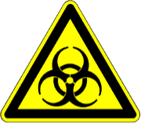

[← Back to Operational Safety](../operational-safety.qmd)

::: {.door-rules}

{width=90px}

**Authorized persons only.** Group 2 organisms are handled in this lab.

1. **Enter only with authorization.** Lab safety test and introduction by the BSO first. BSc/MSc students never work alone. No visitors.
2. **Wear your PPE.** Lab coat (buttoned), safety glasses, long trousers, closed shoes. Gloves when handling chemicals or biological material. Lab coat and gloves stay in the lab.
3. **No food, drinks, or cosmetics.** No eating, drinking, or storing food. No mouth pipetting. Do not touch your face, phone, or door handles with gloves.
4. **Group 2 material only in the biosafety cabinet.** Keep containers closed, avoid splashes and aerosols, Bunsen burner in the cabinet only foot-operated and only when needed. Volatile or toxic chemicals and gases only in the fume hood.
5. **Clean up and autoclave.** Clean your workplace after use. All biological waste is autoclaved. Sharps go into the sharps container. No chemicals or active biological material down the drain.
6. **Wash your hands and report everything.** Wash and disinfect your hands before leaving. Report every spill, injury, and near miss to the BSO.

::: {.door-emergency}
**Emergency:** +41 44 342 11 88 (mobile) · 888 from the phone at the safety station: exit, turn right, before the elevators\
**BSO:** Dr. Jakub Tkaczuk, +41 44 632 31 62\
**Deputy:** Bettina Melberg, +41 44 632 08 42
:::

*Pregnant or breastfeeding? Some chemicals and organisms in this lab can harm pregnancy. Please inform the BSO confidentially before working here.*

:::
