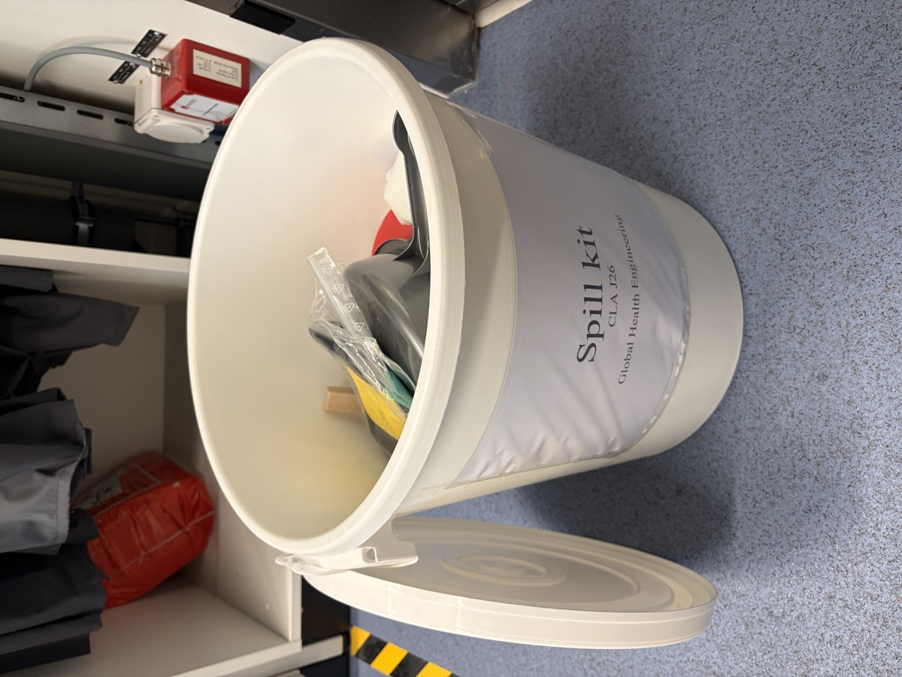

::: {.callout-note}
**Active ECOGEN notification:** [A260150-00](_biological/06_project_list.qmd), class 2, CLA J26
:::

# Validity {#validity}

This biological safety concept forms a binding framework for the implementation of the statutory requirements for activities involving pathogenic or Genetically Modified Organisms (GMO) in contained systems (Levels 1 and 2)[^1]. This safety concept incorporates the measures adopted by Global Health Engineering for occupational safety and for the safety of people, animals, and the environment. 

The safety concept is based on the [Safety concept according to ESV and SAMV for Level 2 laboratories](https://www.bafu.admin.ch/dam/bafu/en/dokumente/biotechnologie/uv-umwelt-vollzug/sicherheitskonzept-esv-samv-laboratorien-stufe-2.docx.download.docx/A00_UV-0817-E-ESV2019_Labor.docx) and the corresponding guidelines of the Federal Office for the Environment (FOEN): [Operational safety concepts according to Containment Ordinance (ContainO)](https://www.bafu.admin.ch/dam/bafu/en/dokumente/biotechnologie/uv-umwelt-vollzug/betriebliches_sicherheitskonzeptnachdereinschliessungsverordnung.pdf.download.pdf/operational_safetyconceptsaccordingtocontainmentordinancecontain.pdf). Various templates for operating instructions and rules of conduct have been adapted to the particular lab and are listed in the Annexes together with the already existing company documents containing performance standards for environmental and occupational safety and quality assurance.

This safety concept, as well as the general [Biosafety Concept of ETH Zurich](https://ethz.ch/content/dam/ethz/associates/services/Service/sicherheit-gesundheit-umwelt/files/biosicherheit_neu/en/Biosafety_concept.pdf), is updated whenever the risk changes, especially when:

- new working methods are adopted;
- new organisms are handled;
- new equipment relevant to biological safety is introduced;
- existing premises are converted for other purposes, or new rooms are used;
- the activities, processes, or the use of rooms have been discontinued (see [Chapter 5.1](#risk_i)).

# Safety objectives {#objectives}

Work in the Global Health Engineering laboratory involves using hazardous chemical and biological substances, including Group 2 parasitic nematodes (*Ascaris suum* and *Toxocara canis*) and Group 1 fungi (see [Appendix 6](_biological/06_project_list.qmd)). In this work, it is impossible to entirely rule out a potential risk to people, animals and the environment. GHE takes the necessary safety measures to protect people, animals and the environment from harmful effects. As an employer, the professor of GHE acknowledges its responsibility for occupational safety and protecting its employees' health and takes the necessary measures accordingly[^2].

# Safety organization {#organization}

## Responsibility and liability {#organization_i}

The head of GHE assumes the operative responsibility for ensuring the safety of people, the environment, and safety at the workplace[^3]. They ensure that the safety concept is implemented and followed and have established the organizational structure necessary for this purpose. At least one person has been entrusted with monitoring biological safety, the precise details concerning status, duties, and responsibilities have been set out in the job description. These job descriptions also specify the duties, tasks, and competencies of the laboratory managers and project leaders in everyday situations and emergencies. The job descriptions are an integral part of this specific biosafety concept. The necessary financial and personal resources to maintain biological and chemical safety are made available by GHE.

As a matter of principle, ETH Zurich as an institution (not an individual ETH employee) shall be held liable to third parties, both companies and persons. However, ETH may take recourse against employees who fail to comply with safety provisions deliberately or through gross negligence, thereby inflicting harm on a third party for which the ETH is liable. This covers the liability issue. The criminal law aspect must also be considered. Therefore, the following applies to all persons bearing responsibility for safety at ETH: *The responsibility of persons under criminal law is derived from their sphere of responsibility concerning observing safety rules. Only those persons who, by their position, can prevent hazards through their intervention can be held accountable under criminal law. This is the case if they failed to intervene where intervention would have been appropriate and possible.*

## Organization chart {#organization_chart}

The positions of the Biosafety Officer (BSO) and the BSO deputy are shown below. The general safety organization of GHE is described in the [Operational Safety Concept](operational-safety.qmd#organization_ii).

| role                                     | name                       | building / room | phone number     | email                  |
| ---------------------------------------- | -------------------------- | --------------- | ---------------- | ---------------------- |
| head of group, employer                  | Prof. Dr. Elizabeth Tilley | CLD D 10.1      | +41 44 632 88 28 | tilleye@ethz.ch        |
| Biosafety Officer (BSO), lab manager     | Dr. Jakub Tkaczuk          | CLD D 2.1       | +41 44 632 31 62 | jtkaczuk@ethz.ch       |
| BSO deputy                               | Bettina Melberg            | CLA F 33        | +41 44 632 08 42 | bmelberg@ethz.ch       |
| project leader, ECOGEN A260150-00        | Jules Peter                | CLA J 26        | +41 79 341 45 51 | jupeter@ethz.ch        |

## Duties of the Biosafety Officer, the Laboratory Leader, and the Project Leaders {#organization_ii}

The status, duties and responsibilities of the Biosafety Officer (BSO) and the Project Leaders (PL) are set out in the job description of the respective employees. GHE conforms to the respective guidelines of the Swiss Agency for the Environment, Forests and Landscape (SAEFL)[^4].

The duties of the BSO, the BSO deputy, and PL are described in detail in [Appendix 1](_biological/01_duties_of_BSO_and_project_leaders.qmd).

## List of employees {#organization_iii}

Group 2 microorganisms represent a potential hazard for employees. GHE keeps a list of persons who work with Group 2 organisms (see [Appendix 2](_biological/02_list_of_employees_SAMV.qmd)) and, if required, arranges for a health file to be created according to the Ordinance on the Protection of Personnel from Hazards due to Microorganisms (SAMV) (see [Chapter 4.4](#emergency_iv)). GHE shall provide this list to SSHE-BSO upon request.

# Emergency organization: Planning and incident management {#emergency}

## Emergency telephone numbers and contacts for safety issues {#emergency_i}

The emergency telephone numbers and contact addresses of persons able to provide information on safety matters are posted in the laboratory next to the door and at the safety station on the corridor. There is no phone inside CLA J26; emergency calls are made from a mobile phone (+41 44 342 11 88) or from the phone at the safety station on the corridor (when you leave CLA J26, turn right; the phone is before the elevators, about 10 m from the door) by dialing 888. This is of paramount importance for dealing with an incident quickly. This list is provided in [Appendix 3](_biological/03_emergency_telephone_numbers_and_contacts_for_safety.qmd).

## Emergency planning: Procedures in case of incidents in the laboratory and crisis situations {#emergency_ii}

When working with organisms, emergencies, which vary in severity, may arise owing to spillage of infectious material, release of aerosols, injuries, fire, explosion and water discharge. While minor incidents are generally dealt with by the person(s) who caused them, with the assistance of the Biosafety Officers if appropriate, the emergency services must always be alerted in the event of serious incidents. The procedures are described in [Appendix 4](_biological/04_emergency_planning_and_procedures.qmd).

CLA J26 is equipped with a spill kit for chemical and biological spills and a first aid kit for injuries in the chemistry and biology lab. The spill kit is a single-use bucket for incineration waste, labelled *Spill kit CLA J26*, placed under the lab coats. The first aid kit is placed above the sink. After use, the BSO replaces the spill kit and refills the first aid kit.

{width=40% fig-align="center"}

## Report sheet for laboratory incidents {#emergency_iii}

In a laboratory incident involving Class 2 activities, the precise circumstances leading to contamination of the body or an injury must be recorded, even if only a minor one. All laboratory incidents must be reported to the BSO and the supervisors and recorded with the report sheet in [Appendix 5](_biological/05_report_sheet_for_lab_incidents.qmd). Incidents involving personal injury or property damage must also be reported to SSHE: [accident or medical event](https://ethz.ch/staffnet/en/service/safety-security-health-environment/safety-security-health-environment/notfall-was-tun/unfall-oder-medizinisches-ereignis.html), [property damage](https://ethz.ch/staffnet/en/service/safety-security-health-environment/safety-security-health-environment/sachschaden.html).

The BSO, supervisors, and SSHE use the report sheets for laboratory incidents to investigate the causes of incidents so that measures can be initiated to prevent and reduce risks. The BSO, SSHE, and supervisors keep the completed report sheets on file for at least five years.

## Health file {#emergency_iv}

The employees' occupational health data are collected in the so-called health file in exceptional cases described below. The Occupational Health Services of ETH Zurich (currently represented by several occupational physicians) keep a health file for those employees for whom a medical examination is necessary as a direct result of their work. This could involve vaccinations, medical diagnoses and measures after an occupational/laboratory accident, exposure to microorganisms or if there is a reason to suspect an infectious disease was acquired during work activities.

The following details are recorded in the health file (according to Art. 14 (3) SAMV):

- Reasons for the particular medical precautions.
- Investigations into the employees' immune status.
- Vaccinations.
- Results of medical examinations after accidents, incidents, exposure to microorganisms, and suspected infection during occupational activity.

The attending doctor keeps the health file as a separate dossier or as a component/folder in an existing medical history if, for example, the person examined also consults the same doctor privately[^5].
Suppose other work-related medical examinations, e.g., concerning radiation protection, are also carried out by the doctor involved. In that case, these shall be included or combined in the same personal dossier.

No vaccination exists against *Ascaris* or *Toxocara*, and no special medical examinations are required for activity A260150-00 (as declared in ECOGEN). After a suspected ingestion of eggs, the affected person consults the ETH occupational physician, who decides on diagnostics and treatment (albendazole for *T. canis*, mebendazole for *A. suum*). In that case a health file is opened.

## Safety documentation for emergency services {#emergency_v}

To ensure a reliable response in the event of fire, flooding, power failure or other incidents, the emergency services (B-Pikett, fire brigade, police) are informed about the organisms used, their storage and working locations, the protective measures required, and the inactivation methods. In the canton of Zurich, this is the *Betriebseinsatzdokumentation Biologie* (BED-B) according to §31 ABCV, which the BSO submits electronically to AWEL (Sektion Biosicherheit) and keeps up to date. For GHE, the BED-B covers room CLA J26 (BSL2), the storage of *Ascaris suum* and *Toxocara canis* eggs at 4 °C, and inactivation by autoclaving.

# Risk assessment {#risk}

## Compulsory reporting of BSL2 activities {#risk_i}

The risks of an activity and the reporting and authorization requirements according to ESV (Art. 8-10) and SAMV (Art. 5, 6) are identified/established early. To this end, before the start of the activity, the project leaders report to the BSO all new activities and significant changes, e.g., the use of new organisms with significantly different characteristics or significant new knowledge concerning safety-related aspects of an ongoing activity.

The BSO and GHE inform the federal authorities, using [ECOGEN](https://www.ecogen.admin.ch/public/#/), about the start and the end of the BSL2 activities. Following the advice of AWEL, no end date is entered when a notification is created, unless the end of the activity is certain; otherwise the notification is set to inactive on that date. Purely administrative changes (new persons, addresses, phone numbers) are submitted as an *administrative change / supplement*. Questions are addressed to the Federal Contact Point for Biotechnology (KBB, [contact.biotech@bafu.admin.ch](mailto:contact.biotech@bafu.admin.ch)).

The risk assessment for each activity is part of its ECOGEN notification. For activity A260150-00, the main points are summarized in [Appendix 6](_biological/06_project_list.qmd).

## Project list and inventory of biological agents {#risk_ii}

The BSO keeps an overview of the activities involving organisms within their area of responsibility and records them in [Appendix 6](_biological/06_project_list.qmd). The project list is updated at least every six months and whenever new reports and requests occur. The list is accessible to SSHE at any time.

# Safety measures and rules of conduct {#measures}

## Access control and signalization of BSL2 working areas {#measures_i}

Access to the BSL2 laboratory facility is restricted to authorized persons only and is governed by the containment concept of GHE. Nonetheless, it must always be ensured that, in the event of an incident, e.g., fire, the emergency services can access the area quickly and safely (fire brigade key) and that the escape routes are secured. The rules on access and the list of users with access to the level 2 area are provided in [Appendix 7](_biological/07_user_list_with_access_to_BSL2.qmd).

The entrance area to level 2 laboratories is signalized, and warning signs (restricted access and warning of the hazards emanating from the organism) are displayed. The guidelines for signalization of laboratories and equipment with the "Biohazard" warning symbol are described in [Appendix 8](_biological/08_meaning_and_use_of_biohazard_symbol.qmd).

## Instructions for safe working {#measures_ii}

### Operating instructions and rules of conduct {#measures_ii_a}

Rules concerning occupational safety and environmental safety at GHE are set out in the operating instructions, work instructions or the Standard Operating Procedures (SOPs). These documents are provided in [Appendix 9](_biological/09_SOPs.qmd).

### Laboratory safety rules {#measures_ii_b}

The staff of GHE adhere to the legally binding "Principles of good microbiological practice" according to Annex 3 of SAMV. Based on it, the laboratory rules applicable to the laboratory of GHE are adapted and supplemented accordingly. The laboratory rules, including the specific rules for BSL2, are described in [Appendix 5 of the Operational Safety Concept](_operational/05_general_lab_workshop_rules.qmd). The most important rules are posted on the door of CLA J26 ([door poster](_operational/10_wet_lab_door_rules.qmd)).

### Use of class 2 biological safety cabinet {#measures_ii_c}

Correct operation and use, including regular maintenance of the biological safety cabinets (BSC), are essential for protecting people and the environment, as well as for the quality of research and test results and are explained in detail in a separate information sheet. GHE is responsible for the maintenance of the safety cabinets. [Appendix 10](_biological/10_use_of_class_2_cabinets.qmd) contains information on the use of class 2 safety cabinets. Detailed information is available in the FOEN *Guideline for the use of microbiological safety cabinets when handling human-pathogenic microorganisms* (2nd edition, 2024) and in EN 12469:2025. Open flames disturb the air flow of the BSC and can damage the HEPA filters (EN 12469:2025, AWEL BSO letter 3/26). Therefore, only a flat, foot-operated Bunsen burner is used in the BSC, and it is ignited only when needed.

### Biological safety during centrifuging {#measures_ii_d}

To prevent the formation of aerosols during centrifugation and the dispersal of organisms, users follow the instructions of the centrifuge manufacturer (Thermo Fisher Scientific Sorvall ST8). The centrifuge has no aerosol-tight buckets. The risk is low because *Ascaris* and *Toxocara* eggs (about 50–90 µm) are too large to be inhaled and infect only by ingestion. The following measures apply to all samples containing Group 2 organisms:

- only tightly closed screw-cap tubes are used, filled to at most ¾ and balanced;
- after the run, the lid stays closed for at least 5 minutes before opening, so droplets can settle;
- tubes are checked for breakage and opened only inside the BSC;
- if a tube breaks, the lid is kept closed for 30 minutes, then the rotor and buckets are cleaned with detergent-soaked wipes according to the [emergency plan](_biological/04_emergency_planning_and_procedures.qmd), and all wipes are autoclaved.

### Prevention of infectious diseases transmissible by blood {#measures_ii_e}

GHE does not work with human or animal blood or blood-containing body fluids, so the SSHE annex *Measures to prevent infectious diseases transmissible by blood* does not apply. Sharps (needles, scalpels, broken glass) are nevertheless handled according to the ETH information sheet [*Working with sharps*](media/MB_Sharps_EN.pdf): their use is avoided where possible, needles are never recapped, and sharps are collected in a puncture-proof sharps container with a biohazard label, which is closed when ¾ full and autoclaved before disposal.

## Training and information to ensure safety at work {#measures_iii}

At ETH Zurich, training is essential to ensure people's and the environment's safety. ETH Zurich offers its BSO external and internal training courses. The respective project manager is responsible for inducting new employees and instructing them in biosafety (they can, however, delegate this task to the BSO).

Every person working with Group 2 organisms is instructed before starting the work and at least once per year afterwards (annual refresher). The instruction covers the organisms and their risks, the protective measures, the laboratory rules, the emergency procedures, waste disposal, and maternity protection (see [Operational Safety Concept, chapter 7](operational-safety.qmd#training)). Each instruction is confirmed by the signatures of the employee and the instructor and stored in the record of instructions and trainings ([Appendix 8 of the Operational Safety Concept](_operational/08_training_certificates.qmd)).

## Standards for laboratory cleaning {#measures_iv}

### Disinfection and cleaning {#measures_iv_a}

The hygiene plan serves to promote personal safety at work. Also, it helps to minimize the escape of organisms into the environment. Factors such as the spectrum of activity, concentration used, and exposure time are crucial for the optimal use of cleaning agents and disinfectants. Only disinfectants effective for dealing with the organisms to be rendered inactive may be used, and the manufacturer's instructions regarding their use must be followed. The instructions for use and safety datasheets of the products employed by GHE is available in the [Hygiene Plan](_biological/11_hygene_plan.qmd).

### Safety instructions for the cleaning service {#measures_iv_b}

GHE draws up cleaning regulations and informs Building Services (facility management) about these regulations. Building Services shall pass the regulations to the cleaning service and instruct them accordingly. If special conditions apply in individual laboratories, the BSO must inform the cleaning staff about them. The specific safety instructions for cleaning personnel are integral to the biosafety concept and are provided in [Appendix 12](_biological/12_safety_for_cleaning_service.qmd).

## Disposal of biologically contaminated waste {#measures_v}

### Disposal plan {#measures_v_a}

Correct disposal of contaminated waste is a crucial requirement for preventing the escape of organisms from a laboratory and minimizing the risk to people and the environment. A separate disposal plan for biologically contaminated waste ([Appendix 14](_biological/14_disposal_plan_for_bio_contaminated_waste.qmd)) contains detailed information on how the handling of waste is organized[^6][^7].

### Inactivating biological waste by autoclaving {#measures_v_b}

The operation of the autoclave is laid down in its operating instructions ([user manuals](https://drive.google.com/drive/folders/1-gGl0Jj20gXjfeDVtdbEAdviQkH1oo-P?usp=sharing)). The autoclave (HMC) is located in CLA J26. Autoclaving procedures are selected so that all biological waste is safely inactivated: all waste containing *Ascaris* or *Toxocara* eggs is autoclaved at 121 °C for at least 20 minutes. Helminth eggs are highly resistant to chemical disinfectants, so autoclaving is the only inactivation method used for them. The effectiveness of inactivation is checked with heat indicator tape on every load, and the autoclave is serviced and calibrated by the manufacturer every two years (see [Appendix 13](_biological/13_service_plan.qmd)).

## Purchase, servicing, and maintenance of equipment {#measures_vi}

### Declaration of conformity and manuals {#measures_vi_a}

GHE ensures that the equipment used in its lab complies with European safety regulations. The [declarations of conformity](https://drive.google.com/drive/folders/12BPhWmaUQXrYuQz66WqhErdkoFfIk6gz?usp=sharing) and the [user manuals](https://drive.google.com/drive/folders/1-gGl0Jj20gXjfeDVtdbEAdviQkH1oo-P?usp=sharing) are stored online and accessible at any time.

### Responsibility for servicing and maintenance of equipment {#measures_vi_b}

All technical equipment is serviced regularly so that, apart from the quality of the research and diagnostic results, the safety of the workforce and the protection of people and the environment in general can be ensured. Service plans for individual equipment items and the rules concerning responsibilities are set down in writing. They are available in [Appendix 13](_biological/13_service_plan.qmd).

## Transportation of organisms or infectious biological agents {#measures_vii}

GHE adheres to the statutory requirements and follows the relevant national and international transport regulations[^8] on labelling and packing for transporting organisms or infectious biological agents. Suppose a sample containing organisms is transported outside the laboratory for diagnostic or research purposes. In that case, the smallest quantities and lowest concentration of cells possible[^9] are packed and transported with appropriate labelling. If waste involves a contamination risk, e.g., secretions or excreta, or strong-smelling or nauseating waste is transported, the labelling and packing regulations listed in [Appendix 14](_biological/14_disposal_plan_for_bio_contaminated_waste.qmd) are applied.

In summary, the following applies:

| UN number | official description                                              | hazard label | ADR packaging instructions | field of application                                  |
| --------- | ----------------------------------------------------------------- | ------------ | -------------------------- | ----------------------------------------------------- |
| UN 3373   | biological substances of category B                               | Class 6.2    | P650                       | Group 2 (possibly 3) and category B of microorganisms |
| UN 3245   | genetically modified microorganisms                               | Class 9      | P904                       | Group 1 microorganisms                                |
| UN 1845   | Dry ice (solid ${\rm CO_2}$), only to be marked for air transport | Class 9      |                            | Packaging material                                    |
| UN 1977   | Liquid nitrogen                                                   | Class 2.2    |                            | Packaging material                                    |

Isolated *Ascaris suum* and *Toxocara canis* eggs are received from an external collaborator as UN 3373 (P650, triple packaging). On arrival, the package is opened inside the BSC, the receipt (species, batch, quantity, date) is documented, and the eggs are stored at 4 °C in sealed, labelled secondary containers in the fridge in CLA J26, which carries a biohazard label. Inside the building, samples are moved only in closed, leak-proof, and break-proof secondary containers.

## Chemical safety {#measures_viii}

### Storage and quantities {#measures_viii_a}

Chemicals are kept in the laboratory only in the quantities needed for uninterrupted daily work. Highly flammable liquids are kept in suitable, marked cabinets. When handling and storing chemicals, the stipulations of the safety data sheets are followed. The chemical inventory, the main chemical risks, and the safety information for each chemical are provided in the [Chemical Safety](chemical-safety.qmd) section.

### Disposal {#measures_viii_b}

All chemical waste, such as acids and alkalis or (chlorinated) organic solvents, is collected and disposed of in accordance with the [ETH waste disposal concept](https://ethz.ch/content/associates/services/en/organisation/abteilungen/sicherheit-gesundheit-umwelt/sgu-services/umwelt/sonderabfall.html). Biological waste that also contains chemicals is first inactivated by autoclaving and then disposed of as hazardous chemical waste.

## Planning, building, modification, decommissioning, and relocation {#measures_ix}

One of the tasks of the BSO is to keep the safety precautions in line with the latest scientific and technical developments, even if this requires structural modifications. The BSO is consulted whenever building work or structural modifications are carried out in CLA J26 and whenever technical changes are made to safety-relevant facilities, such as the BSC or the autoclave.

For structural modifications, changes in use, decommissioning, and relocation, specially adapted safety precautions are taken at the appropriate time, especially to decontaminate the laboratory and the technical facilities. If risks due to organisms cannot be completely ruled out despite prior decontamination (e.g., when removing BSC filters), this is covered explicitly in the incident procedures for that phase of the work.

# Appendices {#appendices}

- [Appendix 1. Duties of Biosafety Officer and Project Leaders](_biological/01_duties_of_BSO_and_project_leaders.qmd)
- [Appendix 2. List of employees according to SAMV](_biological/02_list_of_employees_SAMV.qmd)
- [Appendix 3. Emergency telephone numbers and contacts for safety issues](_biological/03_emergency_telephone_numbers_and_contacts_for_safety.qmd)
- [Appendix 4. Emergency planning: Procedures in case of incidents in the laboratory](_biological/04_emergency_planning_and_procedures.qmd)
- [Appendix 5. Report sheet for laboratory incidents](_biological/05_report_sheet_for_lab_incidents.qmd)
- [Appendix 6. Project list](_biological/06_project_list.qmd)
- [Appendix 7. Rules on access and user list for level 2 working areas](_biological/07_user_list_with_access_to_BSL2.qmd)
- [Appendix 8. Meaning and use of the «Biohazard» warning symbol](_biological/08_meaning_and_use_of_biohazard_symbol.qmd)
- [Appendix 9. Standard Operating Procedures](_biological/09_SOPs.qmd)
- [Appendix 10. Use of class 2 biological safety cabinets](_biological/10_use_of_class_2_cabinets.qmd)
- [Appendix 11. Hygiene plan and list of disinfectants](_biological/11_hygene_plan.qmd)
- [Appendix 12. Safety during cleaning of laboratories by the cleaning service](_biological/12_safety_for_cleaning_service.qmd)
- [Appendix 13. Equipment service plan and responsibilities](_biological/13_service_plan.qmd)
- [Appendix 14. Disposal plan for biologically contaminated waste](_biological/14_disposal_plan_for_bio_contaminated_waste.qmd)

## Further documents {#documents}

| Document                                                     | Storage location |
| ------------------------------------------------------------ | ---------------- |
| Organization chart                                           | [Chapter 3.2](#organization_chart) |
| Job descriptions of the BSO and BSO deputy                   | personnel files (HR) |
| ECOGEN notification A260150-00 incl. risk assessment         | [ECOGEN](https://www.ecogen.admin.ch/), printed copy in the BSO office (CLD D 2.1) |
| Record of instructions and trainings                         | [Operational Safety, Appendix 8](_operational/08_training_certificates.qmd) |
| Autoclave operating instructions                             | [user manuals](https://drive.google.com/drive/folders/1-gGl0Jj20gXjfeDVtdbEAdviQkH1oo-P?usp=sharing) |
| Equipment documents and declarations of conformity           | [declarations of conformity](https://drive.google.com/drive/folders/12BPhWmaUQXrYuQz66WqhErdkoFfIk6gz?usp=sharing), paper copies in CLD D 2.1 |
| Service contracts and service reports                        | BSO office (CLD D 2.1) |
| Safety data sheets of the chemicals used                     | [Chemical Safety](chemical-safety.qmd), printed copies in CLA J26 |
| BED-B (safety documentation for emergency services)          | AWEL online database |

[^1]: A laboratory where work is done with pathogenic or Genetically Modified Organisms falls within the scope of the Containment Ordinance from 25 August, 1999 on the Contained Use of Organisms (Einschliessungsverordnung, **ESV**, SR 814.912) and the Ordinance on the protection of personnel from hazards due to microorganisms from 25 August, 1999 (**SAMV**, SR 832.321). The scopes of these ordinances complement each other and contribute to protection of the environment, population, and the health of individual employees.
[^2]: The University defines its protection goals to prevent accidents at work as well as harmful and undesirable effects on the environment and the population.
[^3]: According to Article 7 Paragraph 4 of Ordinance 3 dated 18 August 1993 to the Employment Act (Health Protection, ArGV 3, SR 822.113), the following applies: "The rules regarding responsibilities in the plant/laboratory do not exempt the employer from his responsibility to protect health".
[^4]: [Guideline: Biosafety Officer (BSO) – Status, duties and responsibilities](https://www.bafu.admin.ch/bafu/en/home/topics/biotechnology/publications-studies/publications/biosafety-officers-bso.html).
[^5]: The attending doctor does not necessarily have to be an occupational health specialist but may, according to SAMV, also be a company doctor or an independent medical examiner. What is crucial, however, is that this person knows the work situation and the working conditions so that a link to the workplace can be established during the health assessment and the necessary plan of occupational health measures can be drawn up. In this regard, compare Art 2.4 of EKAS guideline 6508 on the calling-in of occupational health doctors and other occupational safety specialists.
[^6]: See the implementation guide issued by SAEFL: M. Buletti (2004) [*Elimination des déchets médicaux*](https://www.bafu.admin.ch/bafu/fr/home/themes/dechets/publications-etudes/publications/elimination-des-dechets-medicaux.html). Swiss Federal Office for the Environment FOEN.
[^7]: See the [*Safety measures in medical microbiology diagnostic laboratories*](https://www.bafu.admin.ch/dam/bafu/en/dokumente/biotechnologie/uv-umwelt-vollzug/sicherheitsmassnahmeninhumanmedizinisch-mikrobiologischendiagnos.pdf) (2015) Swiss Expert Committee for Biosafety (SECB), Federal Office for the Environment FOEN, Federal Office of Public Health FOPH.
[^8]: International transport regulations: [*UN Recommendations on the Transport of Dangerous Goods, Model Regulations*](https://unece.org/rev-21-2019) Rev. 21 (2019).
[^9]: The shipping of concentrated organisms in the form of cultures belonging to Group 2 or 3 and, according to Category A international regulations, must be carried out by the laboratory dangerous goods safety adviser or under his supervision and the relevant packing and labelling regulations must be complied with. For the function of the safety of hazardous goods adviser, refer to the [*Ordinance on Dangerous Goods Safety Advisers for the transport of hazardous materials by road, rail and waterways*](https://www.fedlex.admin.ch/eli/cc/2001/268/fr) of 15 June 2001 SR 741.622 (Ordonnance sur les conseillers à la sécurité, OCS).